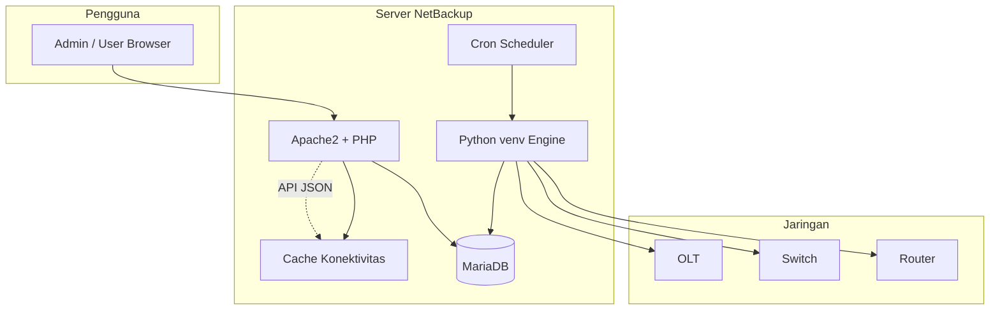

# NetBackup — Backup Otomatis Perangkat Jaringan

**Versi:** 2.8.1  
**Author:** [Erlangga Alfian](mailto:erlanggaalfian82@gmail.com)  
**Source code:** https://github.com/erlanggaalfian/netbackup.git

NetBackup adalah aplikasi web untuk administrator jaringan yang perlu **backup konfigurasi perangkat multi-vendor secara otomatis, terpusat, dan aman**. Engine backup dan pengecekan konektivitas berjalan di server — browser hanya menampilkan antarmuka dan hasil agregat.

---

## Daftar Isi

- [Fitur Aplikasi](#fitur-aplikasi)
- [Halaman Web](#halaman-web)
- [Arsitektur](#arsitektur)
- [Persyaratan Server](#persyaratan-server)
- [Struktur Direktori](#struktur-direktori)
- [Struktur Database](#struktur-database)
- [Source Code Resmi](#source-code-resmi)
- [Instalasi Baru](#instalasi-baru)
- [Setup Admin Pertama](#setup-admin-pertama)
- [Upgrade / Pembaruan](#upgrade--pembaruan)
- [Uninstall](#uninstall)
- [Backup Database ke Google Drive](#backup-database-ke-google-drive-opsional)
- [Keamanan](#keamanan)
- [Troubleshooting](#troubleshooting)
- [Lisensi & Kontribusi](#lisensi--kontribusi)

---

## Fitur Aplikasi

### Manajemen pengguna

| Fitur | Keterangan |
|-------|------------|
| Login & session | Proteksi session PHP, CSRF token |
| Role | `admin` dan `user` |
| Remember me | Token login tersimpan aman |
| Setup admin | Halaman `setup.php` saat belum ada admin |
| Audit log | Semua aktivitas penting tercatat |

### Organisasi perangkat (Site & Role)

- **Site** — lokasi/cabang perangkat (Jakarta, Surabaya, POP-A, dll.)
- **Role** — fungsi perangkat (Core, Distribution, Access, OLT, Router, BTS, dll.)
- Filter kombinasi site + role + pencarian nama/IP/lokasi
- Pagination fleksibel (25–200 baris per halaman)

### Manajemen perangkat

- Tambah, edit, hapus perangkat (termasuk bulk delete)
- Backup manual satu klik per perangkat
- Status konektivitas per baris (refresh via API backend)
- Protokol **SSH** atau **Telnet** dengan port kustom
- Password perangkat **terenkripsi AES-GCM** di database
- Vendor didukung: Cisco, Huawei, Juniper, Mikrotik, ZTE, Arista, VyOS, dan lainnya

### Interactive shell

Perangkat yang membutuhkan sesi CLI interaktif (`invoke_shell`):

- Flag `is_interactive` per vendor
- Command backup kustom per vendor
- Cocok untuk OLT, router dengan paging khusus, atau CLI non-standard

### Monitoring konektivitas (backend)

Semua pengecekan dijalankan **di server PHP/Python** — bukan N× fetch dari browser.

| Metode | Fungsi |
|--------|--------|
| ICMP Ping | Cek respons ping ke IP perangkat |
| TCP Check | Cek port SSH/Telnet sesuai protokol |
| Cache 30 detik | File `cache/device_connectivity.json` |

**Dashboard:**

- Ringkasan jumlah OK / Gagal (ping & koneksi)
- Daftar perangkat bermasalah dengan tombol klik ke halaman Perangkat
- Auto-refresh setiap 30 detik

### Backup otomatis & manual

| Mode | Cara kerja |
|------|------------|
| **Otomatis** | Cron Linux (`www-data`) menjalankan `run_scheduled_backup.py` setiap jam |
| **Jadwal** | Harian, mingguan (pilih hari), bulanan (tanggal 1–28) via halaman Jadwal |
| **Manual** | Tombol backup di halaman Perangkat → `backup_single.py` via Paramiko |

Engine backup: **Python 3 + Paramiko + Cryptography**.

### Hasil backup

- Riwayat backup dengan filter & pagination
- Lihat isi konfigurasi langsung di browser
- Unduh file backup
- Hapus massal

### Log aktivitas

- Login, backup sukses/gagal, perubahan perangkat/jadwal/vendor
- Bulk delete & clear all (admin)
- Filter dan pagination

### Performa UI

- Indeks database untuk tabel `backups` dan `devices`
- Pagination konsisten (`<< < 1 2 3 > >>`)
- Data langsung tampil saat halaman dibuka
- Lazy load riwayat backup

---

## Halaman Web

| Halaman | Fungsi |
|---------|--------|
| `dashboard.php` | Statistik, grafik, panel konektivitas realtime |
| `devices.php` | Inventaris perangkat, backup manual, status koneksi |
| `backups.php` | Riwayat & unduh hasil backup |
| `schedule.php` | Jadwal backup otomatis per perangkat |
| `vendors.php` | Definisi vendor & command backup |
| `settings.php` | Pengaturan sistem (Telegram, Google Drive) |
| `logs.php` | Audit trail aktivitas |
| `setup.php` | Buat admin pertama |
| `login.php` | Masuk sistem |

---

## Arsitektur


---

### Stack teknologi

| Komponen | Teknologi |
|----------|-----------|
| Frontend | PHP 8 native, HTML5, CSS3, JavaScript |
| UI | `style/global.css` (tema biru #3081d1) |
| Backend web | PHP PDO, session, CSRF |
| Engine backup | Python 3 + Paramiko + Cryptography |
| Database | MariaDB 10+ / MySQL 8+ |
| Web server | Apache2 (`mod_rewrite`, VirtualHost per domain) |
| Scheduler | Cron (`www-data`) |
| OS | Debian 12 / Ubuntu Server |

### Alur kerja singkat

1. **Login** → dashboard analitik
2. **Vendor** → definisi command backup (+ interactive jika perlu)
3. **Perangkat** → tambah perangkat (site, role, IP, protokol, port)
4. **Jadwal** → aktifkan backup harian/mingguan/bulanan
5. **Cron** → `run_scheduled_backup.py` cek jadwal & backup via SSH/Telnet
6. **Hasil** → disimpan di tabel `backups`, status success/failure
7. **Log** → audit trail di tabel `logs`

---

## Persyaratan Server

- **OS:** Debian 12 atau Ubuntu Server (20.04+)
- **RAM:** minimal 1 GB (disarankan 2 GB+)
- **Disk:** sesuai volume backup
- **Akses:** root/sudo untuk script instalasi
- **Jaringan:** server harus bisa reach IP management perangkat (SSH/Telnet + ICMP jika ping aktif)
- **DNS:** domain harus mengarah ke server jika memakai Let's Encrypt

---

## Struktur Direktori

Setelah instalasi, aplikasi berada di `/var/www/<domain>/`:

```plaintext
/var/www/<domain>/
├── VERSION                          # Nomor versi aplikasi
├── install_server.sh                # Script instalasi baru (setup lengkap)
├── update_server.sh                 # Script upgrade/pembaruan
├── uninstall_server.sh              # Script hapus instalasi (opsional hapus DB)
├── README.md
├── LICENSE
├── Otomatisasi_Backup_Database_ke_Google_Drive.md
├── .htaccess
├── apache/
│   └── netbackup.conf               # Template VirtualHost
├── img/
│   └── logo.png                 # Logo aplikasi (tambahkan sebelum deploy)
├── cache/
│   └── device_connectivity.json     # Cache status ping/SSH (auto)
├── config/
│   ├── db.php
│   └── db_setting.ini               # Dibuat saat install — rahasia, jangan dibagikan
├── python/
│   ├── backup_single.py
│   ├── run_scheduled_backup.py
│   ├── backup_db_to_drive.py
│   ├── db.py
│   ├── telegram_util.py
│   └── requirements.txt
├── sql/
│   └── schema.sql
├── style/
│   └── global.css
├── venv/                            # Python virtualenv
└── web/
    ├── index.php
    ├── dashboard.php
    ├── devices.php
    ├── backups.php
    ├── schedule.php
    ├── vendors.php
    ├── settings.php
    ├── logs.php
    ├── api_dashboard_connectivity.php
    ├── api_device_connectivity.php
    ├── js/
    │   └── auto-filter.js
    └── includes/
        ├── header.php
        ├── navbar.php
        └── footer.php
```

**File sensitif** (tidak ada di repository, dibuat di server):

- `config/db_setting.ini`
- `config/client_secrets.json`, `config/token.json` — Google Drive OAuth

---

## Struktur Database

Database default: `netbackup_db`

| Tabel | Fungsi |
|-------|--------|
| `users` | Akun login (bcrypt) |
| `vendor` | Vendor & perintah backup |
| `sites` | Lokasi perangkat |
| `roles` | Tipe/fungsi perangkat |
| `devices` | Inventaris + kredensial terenkripsi |
| `backups` | Riwayat konfigurasi backup |
| `settings` | Jadwal backup per perangkat |
| `logs` | Audit aktivitas |
| `sys_settings` | Token Telegram, konfigurasi sistem |

---

## Source Code Resmi

Instalasi baru dan upgrade/pembaruan menggunakan **repository yang sama**:

| | |
|---|---|
| **Git** | `https://github.com/erlanggaalfian/netbackup.git` |
| **Halaman** | https://github.com/erlanggaalfian/netbackup |

Unduh source dengan salah satu cara berikut (berlaku untuk **install** dan **upgrade**):

**Opsi A — Git (source code):**

```bash
cd /opt
git clone https://github.com/erlanggaalfian/netbackup.git
cd netbackup
```

**Opsi B — ZIP manual (tanpa Git):**

1. Buka https://github.com/erlanggaalfian/netbackup  
2. Klik **Code** → **Download ZIP**  
3. Ekstrak ke server, misalnya `/opt/netbackup`  
4. Masuk ke folder tersebut: `cd /opt/netbackup`

> Untuk **upgrade**, Anda boleh clone/ekstrak ke folder lain (mis. `/opt/netbackup-upgrade`). Script `update_server.sh` otomatis mendeteksi instalasi yang sudah ada di `/var/www/<domain>`.

---

## Instalasi Baru

### 1. Unduh source

Ikuti langkah unduh di section **[Source Code Resmi](#source-code-resmi)** (`https://github.com/erlanggaalfian/netbackup.git`).

### 2. Jalankan installer

```bash
chmod +x install_server.sh
sudo bash install_server.sh
```

Installer interaktif **11 langkah** — konfigurasi domain, database, Apache, HTTPS, Python venv, dan cron.

**Log instalasi:** `/var/log/netbackup_install.log`

### Input yang diminta installer

| Input | Contoh / default |
|-------|------------------|
| Domain / ServerName | `backup.perusahaan.co.id` |
| Folder instalasi | `/var/www/backup.perusahaan.co.id` |
| Database host, port, nama, user | `localhost`, `3306`, `netbackup_db`, `netbackup_user` |
| Password user DB | auto-generate jika dikosongkan |
| Password root MariaDB | kosongkan jika auth socket |
| Encryption Key | auto-generate jika dikosongkan |
| HTTPS | HTTP / Let's Encrypt / self-signed / manual |
| Google Drive Folder ID | opsional saat install (bisa diisi nanti di Pengaturan) |

### Yang dilakukan installer otomatis

1. Install paket: Apache, PHP, MariaDB, Python, rsync, certbot (jika HTTPS Let's Encrypt)
2. Salin source ke `/var/www/<domain>` (config sensitif tidak ditimpa jika folder sudah ada)
3. Buat database + user + import `sql/schema.sql`
4. Seed `sys_settings` (Telegram & Google Drive) + tulis file `VERSION`
5. Tulis `config/db_setting.ini` + section `[install]`
6. Python venv + pip **hanya library Python** dari `requirements.txt`
7. VirtualHost Apache: `/etc/apache2/sites-available/<namadomain>.conf`
8. HTTPS sesuai pilihan
9. Permission `www-data` + cron backup perangkat (setiap jam)
10. Cron backup DB→Google Drive (03:00) jika `config/client_secrets.json` sudah ada
11. Verifikasi web (curl ke `/login`)

### Tampilan terminal — `install_server.sh`

```text
 _   _      _   ____             _
| \ | | ___| |_| __ )  __ _  ___| | ___   _ _ __
|  \| |/ _ \ __|  _ \ / _` |/ __| |/ / | | | '_ \
| |\  |  __/ |_| |_) | (_| | (__|   <| |_| | |_) |
|_| \_|\___|\__|____/ \__,_|\___|_|\_\\__,_| .__/
                                           |_|

NetBackup Server Installer
Debian 12 / Ubuntu — konsep setup seperti CCTV Monitoring
Versi: v2.8.1
Source: /opt/netbackup

==================================================
 [1/11] Konfigurasi Web & Domain
==================================================
Nama domain / ServerName [netbackup.local]: backup.perusahaan.co.id
Folder instalasi [/var/www/backup.perusahaan.co.id]:

==================================================
 [2/11] Konfigurasi Database
==================================================
(Tekan Enter untuk nilai default)

Database Host [localhost]:
Database Port [3306]:
Database Name [netbackup_db]:
Database User [netbackup_user]:
Password user database (kosong = auto generate): ********

Password root MariaDB/MySQL (kosongkan jika pakai auth socket tanpa password):
MySQL root password:

Encryption Key aplikasi [auto generate]:

==================================================
 [3/11] HTTPS (SSL)
==================================================
  1) HTTP saja (tanpa SSL)
  2) Let's Encrypt (certbot — domain harus mengarah ke server ini)
  3) Self-signed (development / intranet)
  4) Sertifikat manual (path file .crt / .key)

Pilih opsi [1]: 2
Email untuk Let's Encrypt: admin@perusahaan.co.id

==================================================
 Memulai instalasi...
==================================================
Domain     : backup.perusahaan.co.id
Install ke  : /var/www/backup.perusahaan.co.id
Database   : netbackup_db @ localhost:3306
HTTPS      : letsencrypt

Lanjutkan instalasi? [y/N]: y

[14:22:01] [4/11] Update repository & install paket...
✔ Paket sistem terinstall
[14:24:15] [5/11] Menyalin source ke /var/www/backup.perusahaan.co.id...
✔ Source disalin ke /var/www/backup.perusahaan.co.id
[14:24:18] [6/11] Setup database MariaDB/MySQL...
✔ Database dan user dibuat
✔ Schema database diimport
✔ Key sys_settings integrasi siap

Google Drive Folder ID (opsional)
Folder ID:

✔ Versi v2.8.1 ditulis ke /var/www/backup.perusahaan.co.id/VERSION
[14:24:22] [7/11] Menulis db_setting.ini...
✔ db_setting.ini dibuat
[14:24:25] [8/11] Python virtual environment & dependencies...
✔ Python environment siap
[14:25:10] [9/11] Konfigurasi Apache VirtualHost...
✔ VirtualHost HTTP: /etc/apache2/sites-available/backup.perusahaan.co.id.conf
[14:25:15] [10/11] Setup HTTPS (letsencrypt)...
✔ Let's Encrypt aktif untuk backup.perusahaan.co.id
[14:26:40] [11/11] Permission, cache, cron scheduler & verifikasi...
✔ Cron backup perangkat diperbarui (setiap jam)
✔ Verifikasi web OK (HTTP 200 — http://backup.perusahaan.co.id/login)
✔ Instalasi selesai

==================================================
 ✅ NETBACKUP BERHASIL DIINSTALL
==================================================

URL:
  HTTPS : https://backup.perusahaan.co.id/
  HTTP  : http://backup.perusahaan.co.id/

Instalasi:
  Versi       : v2.8.1
  Domain      : backup.perusahaan.co.id
  Folder      : /var/www/backup.perusahaan.co.id
  Apache site : /etc/apache2/sites-available/backup.perusahaan.co.id.conf

Database:
  Host     : localhost:3306
  Database : netbackup_db
  User     : netbackup_user
  Password : <password-yang-dibuat>

Config:
  /var/www/backup.perusahaan.co.id/config/db_setting.ini

Cron (www-data):
  Backup perangkat : setiap jam
  Backup DB→Drive  : belum (butuh client_secrets.json)

Integrasi (isi di Pengaturan):
  Telegram Bot Token & Chat ID
  Google Drive Folder ID : belum diisi

Log instalasi: /var/log/netbackup_install.log

Langkah berikutnya:
  1. Buka URL di browser & selesaikan setup admin (/setup)
  2. Isi Telegram & Google Drive di menu Pengaturan (jika belum)
  3. Salin config/client_secrets.json untuk backup DB otomatis ke Drive
  4. Kelola perangkat, vendor, jadwal backup, dan dashboard

NetBackup siap digunakan.
```

> Output di terminal server ditampilkan berwarna (hijau/biru/kuning). Teks di atas representasi isi yang sama tanpa kode ANSI.

---

## Setup Admin Pertama

1. Buka URL domain di browser (mis. `https://backup.perusahaan.co.id/`)
2. Jika belum ada admin, diarahkan ke halaman **Setup**
3. Buat username dan password admin
4. Login → Dashboard

---

## Upgrade / Pembaruan

Gunakan `update_server.sh` saat ada versi baru. Script ini:

- Auto-detect lokasi install dari Apache `sites-available` atau scan `/var/www`
- Membaca **versi terpasang** dari `{target}/VERSION`
- Backup database sebelum migrasi (`/var/backups/netbackup/`)
- Salin codebase tanpa menimpa `db_setting.ini`, token Google Drive, atau data backup
- Migrasi schema, refresh Python venv, cron, Apache
- Domain URL diambil dari `ServerName` di `/etc/apache2/sites-available/<domain>.conf`

**Log upgrade:** `/var/log/netbackup_update.log`

### 1. Unduh source versi terbaru

Unduh dari **repository yang sama** dengan instalasi:

`https://github.com/erlanggaalfian/netbackup.git`

Ikuti **Opsi A (Git)** atau **Opsi B (ZIP)** di section **[Source Code Resmi](#source-code-resmi)**. Pastikan source yang diunduh adalah versi terbaru.

### 2. Jalankan script upgrade

```bash
chmod +x update_server.sh
sudo bash update_server.sh
```

**Opsi non-interaktif:**

```bash
sudo bash update_server.sh --yes                  # tanpa konfirmasi
sudo bash update_server.sh --yes --version 2.8.0  # set versi langsung
sudo bash update_server.sh --help
```

Default versi di script: `2.8.1` (`DEFAULT_APP_VERSION` di `update_server.sh`). Saat interaktif, versi bisa diinput manual; Enter = pakai file `VERSION` atau default.

Setelah upgrade: hard refresh browser `Ctrl+Shift+R`.

### Tampilan terminal — `update_server.sh`

```text
 _   _      _   ____             _
| \ | | ___| |_| __ )  __ _  ___| | ___   _ _ __
|  \| |/ _ \ __|  _ \ / _` |/ __| |/ / | | | '_ \
| |\  |  __/ |_| |_) | (_| | (__|   <| |_| | |_) |
|_| \_|\___|\__|____/ \__,_|\___|_|\_\\__,_| .__/
                                           |_|

NetBackup Server Updater
Debian 12 / Ubuntu — update tanpa ubah database & kredensial
Versi default: v2.8.1
Source: /opt/netbackup

==================================================
 Deteksi Lokasi Instalasi
==================================================

[14:30:01] Mendeteksi lokasi instalasi NetBackup...
✔ Terdeteksi dari Apache (backup.perusahaan.co.id.conf): /var/www/backup.perusahaan.co.id
✔ Apache site: backup.perusahaan.co.id.conf
✔ Domain: backup.perusahaan.co.id

==================================================
 Ringkasan Update
==================================================
Sumber script  : /opt/netbackup
Target install : /var/www/backup.perusahaan.co.id
Domain         : backup.perusahaan.co.id
Apache site    : /etc/apache2/sites-available/backup.perusahaan.co.id.conf
Database       : netbackup_db @ localhost:3306
Versi terpasang: v2.6.2

Versi release NetBackup
Versi terpasang : v2.6.2
Default script  : v2.8.1
Sumber VERSION  : v2.8.1
Versi yang akan diinstall [2.8.1]:

Versi terpasang : v2.6.2
Versi target     : v2.8.1
Upgrade          : v2.6.2 → v2.8.1

Lanjutkan update? [y/N]: y

==================================================
 Memulai update NetBackup...
==================================================

[14:30:05] Update dimulai (..., versi: v2.6.2 → v2.8.1)
[14:30:05] [1/8] Backup database sebelum migrasi...
✔ Backup database: /var/backups/netbackup/netbackup_db_20260704_143005.sql
[14:30:08] [2/8] Menyimpan konfigurasi & kredensial existing...
✔ Konfigurasi sensitif aman
[14:30:08] [3/8] Menyalin codebase terbaru ke /var/www/backup.perusahaan.co.id...
✔ Versi v2.8.1 ditulis ke VERSION
✔ Folder web diperbarui
✔ Folder python diperbarui
✔ Folder sql diperbarui
✔ Folder style diperbarui
✔ Codebase terbaru tersalin (db_setting.ini & token tidak ditimpa)
[14:30:12] [4/8] Menjalankan migrasi database (schema.sql)...
✔ Migrasi schema selesai (netbackup_db @ localhost)
[14:30:14] [5/8] Memverifikasi konfigurasi Apache...
✔ Konfigurasi Apache valid
[14:30:15] [6/8] Memperbarui dependensi Python Virtual Environment...
✔ Python venv diperbarui
[14:30:45] [7/8] Menerapkan hak akses file & memperbarui cron scheduler...
✔ Permission & cron scheduler diperbarui
[14:30:46] [8/8] Me-restart Apache & verifikasi aplikasi...
✔ apache2 aktif
✔ Web merespons di http://backup.perusahaan.co.id/login (HTTP 200)
✔ Update selesai

==================================================
 ✅ NETBACKUP BERHASIL DIUPDATE
==================================================

URL
  HTTPS: https://backup.perusahaan.co.id/
  HTTP : http://backup.perusahaan.co.id/

Instalasi:
  Versi       : v2.6.2 → v2.8.1
  Domain      : backup.perusahaan.co.id
  Folder      : /var/www/backup.perusahaan.co.id
  Apache site : /etc/apache2/sites-available/backup.perusahaan.co.id.conf

Database:
  Host     : localhost:3306
  Database : netbackup_db
  User     : netbackup_user

Backup DB:
  /var/backups/netbackup/netbackup_db_20260704_143005.sql

Config:
  /var/www/backup.perusahaan.co.id/config/db_setting.ini

Log update: /var/log/netbackup_update.log

Langkah berikutnya:
  1. Hard refresh browser: Ctrl+Shift+R
  2. Verifikasi login & dashboard di browser

db_setting.ini, token Google Drive, dan data backup tidak diubah.
```

### File yang tidak ditimpa saat upgrade

| File / data | Alasan |
|-------------|--------|
| `config/db_setting.ini` | Kredensial database produksi |
| `config/token.json`, `client_secrets.json` | OAuth Google Drive |
| Data tabel `devices`, `backups`, `logs`, dll. | Data operasional |

---

## Uninstall

Gunakan `uninstall_server.sh` untuk menghapus NetBackup dari server. Script ini **tidak** menghapus paket sistem (Apache, PHP, MariaDB, Python).

**Log uninstall:** `/var/log/netbackup_uninstall.log`

### Deteksi otomatis

Sama seperti upgrade: Apache VirtualHost → scan `/var/www` → atau tentukan path manual dengan `--target`.

### Jalankan uninstall

```bash
chmod +x uninstall_server.sh
sudo bash uninstall_server.sh
```

**Opsi:**

```bash
sudo bash uninstall_server.sh --help

# Tanpa konfirmasi utama, database tetap
sudo bash uninstall_server.sh --yes --keep-db

# Hapus sekalian database & user MySQL
sudo bash uninstall_server.sh --yes --drop-db

# Hapus log NetBackup juga
sudo bash uninstall_server.sh --yes --remove-logs

# Target folder spesifik
sudo bash uninstall_server.sh --target /var/www/backup.perusahaan.co.id
```

### Pilihan database (mode interaktif)

Jika dijalankan tanpa `--drop-db` / `--keep-db`, installer akan menanyakan:

```text
  1) Pertahankan database & user (default)
  2) Hapus database & user MySQL
```

| Opsi CLI | Database MySQL |
|----------|----------------|
| *(interaktif, pilih 1)* | Dipertahankan |
| *(interaktif, pilih 2)* | Dihapus |
| `--keep-db` | Dipertahankan |
| `--drop-db` | Dihapus |
| `--yes` saja | Dipertahankan (aman) |

### Yang dihapus vs dipertahankan

| Item | Default uninstall |
|------|-------------------|
| Cron `www-data` (backup + GDrive) | ✅ Dihapus |
| VirtualHost Apache (+ le-ssl) | ✅ Dihapus |
| Sertifikat Let's Encrypt (certbot) | ✅ Dihapus jika ada |
| Folder `/var/www/<domain>` | ✅ Dihapus |
| Database & user MySQL | ❌ Dipertahankan (opsi `--drop-db`) |
| Paket APT | ❌ Tetap terpasang |
| Backup `/var/backups/netbackup/` | ❌ Tetap ada |

### Tampilan terminal — `uninstall_server.sh`

```text
 _   _      _   ____             _
| \ | | ___| |_| __ )  __ _  ___| | ___   _ _ __
|  \| |/ _ \ __|  _ \ / _` |/ __| |/ / | | | '_ \
| |\  |  __/ |_| |_) | (_| | (__|   <| |_| | |_) |
|_| \_|\___|\__|____/ \__,_|\___|_|\_\\__,_| .__/
                                           |_|

NetBackup Server Uninstaller
Menghapus site, cron, dan folder aplikasi — paket sistem tetap terpasang

✔ Terdeteksi dari Apache (backup.perusahaan.co.id.conf): /var/www/backup.perusahaan.co.id

==================================================
 Ringkasan Uninstall
==================================================
Folder app     : /var/www/backup.perusahaan.co.id
Versi          : v2.8.1
Domain         : backup.perusahaan.co.id
Database       : netbackup_db (user: netbackup_user)

==================================================
 Database MySQL
==================================================
  1) Pertahankan database & user (default)
  2) Hapus database & user MySQL

Pilih [1]: 1

Yang akan dihapus:
  • Cron www-data (backup perangkat & Google Drive)
  • VirtualHost Apache (+ le-ssl / certbot jika ada)
  • Folder aplikasi: /var/www/backup.perusahaan.co.id
  • Database MySQL  : DIPERTAHANKAN — netbackup_db

Lanjutkan uninstall? [y/N]: y

✔ Cron NetBackup dihapus dari www-data
✔ VirtualHost dihapus
✔ Database MySQL tidak dihapus
✔ Folder dihapus: /var/www/backup.perusahaan.co.id

==================================================
 ✅ UNINSTALL NETBACKUP SELESAI
==================================================

Database 'netbackup_db' masih ada di MySQL (user: netbackup_user).
```

---

## Backup Database ke Google Drive (Opsional)

Panduan lengkap OAuth 2.0:

👉 **[Otomatisasi_Backup_Database_ke_Google_Drive.md](./Otomatisasi_Backup_Database_ke_Google_Drive.md)**

Script: `python/backup_db_to_drive.py`

---

## Keamanan

| Lapisan | Implementasi |
|---------|--------------|
| Web | CSRF protection, session PHP |
| Database | Prepared statements (PDO) |
| Password user | bcrypt |
| Password perangkat | AES-GCM (`ENCRYPTION_KEY` di `db_setting.ini`) |
| File sensitif | Dilindungi `.htaccess`, simpan hanya di server |
| Server | Jalankan install / upgrade / uninstall hanya sebagai root/sudo |

**File rahasia — jangan dibagikan atau unggah ke publik:**

- `config/db_setting.ini`
- `config/token.json`, `client_secrets.json`, `drive_key.json`
- `venv/`, `cache/device_connectivity.json`

---

## Troubleshooting

### Error SSH: `Error reading SSH protocol banner`

| Penyebab | Solusi |
|----------|--------|
| Protokol salah | Gunakan **Telnet** jika perangkat tidak support SSH |
| Port salah | SSH → 22 (atau custom), Telnet → 23 |
| Firewall/ACL | Pastikan server NetBackup boleh akses port management |

### Apache error

```bash
sudo apache2ctl configtest
sudo tail -50 /var/log/apache2/*-error.log
sudo systemctl status apache2
```

### Cron backup perangkat tidak jalan

```bash
sudo crontab -u www-data -l
sudo /var/www/<domain>/venv/bin/python3 \
  /var/www/<domain>/python/run_scheduled_backup.py
```

### Error `$'\r': command not found` di Linux

```bash
sed -i 's/\r$//' install_server.sh update_server.sh uninstall_server.sh
```

Repository sudah memakai `.gitattributes` (`*.sh text eol=lf`).

### Instalasi / upgrade / uninstall gagal

```bash
sudo tail -50 /var/log/netbackup_install.log
sudo tail -50 /var/log/netbackup_update.log
sudo tail -50 /var/log/netbackup_uninstall.log
```

---

## Lisensi & Kontribusi

**[MIT License](./LICENSE)** — bebas digunakan, dimodifikasi, dan didistribusikan dengan atribusi asli.

### Author

**Erlangga Alfian**  
📧 erlanggaalfian82@gmail.com  
🌐 https://github.com/erlanggaalfian/netbackup.git

Jika project ini membantu:

- Berikan ⭐ pada repository
- Fork & improve
- Submit issue atau pull request